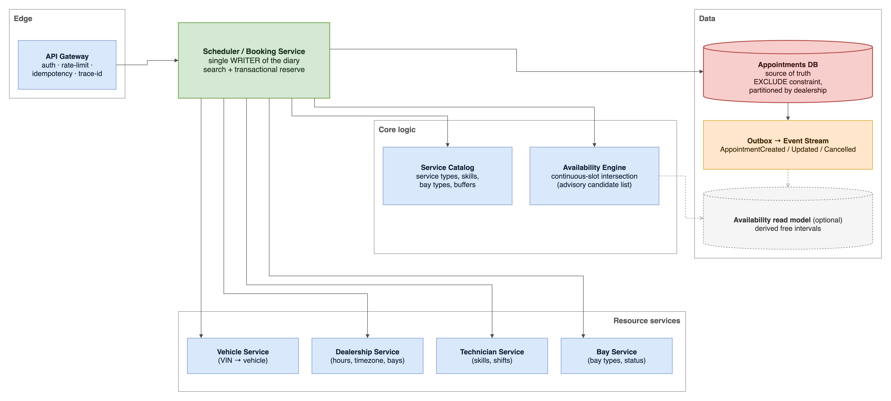
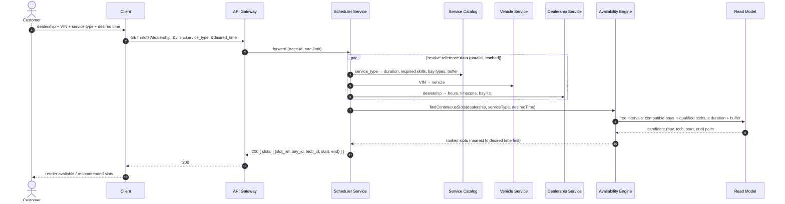
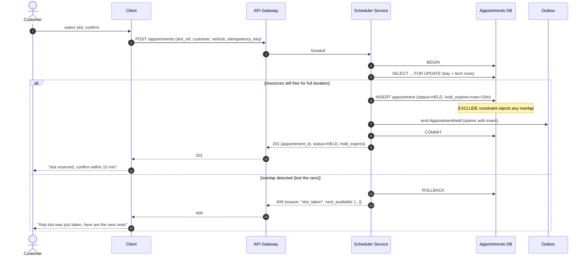

# System Design Document - Scenario A: Unified Service Scheduler


## 1. Overview

One rule drives the whole design:

> "A service appointment is a simultaneous reservation of a physical bay and a skilled human for a continuous block of time whose length is determined by the service type."

A booking is a **promise**, not just a calendar entry. So the whole design depends on one rule: we check availability **two times**, once when searching (best effort), and once when booking (the real, final check). Only the database decides "no double booking".

**Assumptions** (documented rather than left implicit): single-region MVP, but the data model works for many dealerships; services talk over synchronous REST; PostgreSQL is the single source of truth. "Real-time" means: correct at booking time first; live UI updates come later.

---

## 2. Architecture

### 2.1 Requirements (enhanced from my first draft)

**Functional**

- **Search slots**, the customer gives Dealership + Service Type + desired time + vehicle (VIN). The system returns ranked, continuous slots where a matching bay **and** a qualified technician are both free for the full job time (+ buffer).
- **Recommend, don't just reject**, if nothing fits the desired time, return the closest options (or a `409` with `next_available`). A plain "unavailable" loses the visit.
- **Book / reserve**, in one transaction, reserve bay + technician and create a persistent `Appointment`. Idempotent, so a client retry can't create two bookings.
- **Appointment lifecycle**, one record that links Customer ↔ Vehicle ↔ Technician ↔ Bay ↔ Service Type ↔ Time, with status `HELD → CONFIRMED → COMPLETED / CANCELLED / NO_SHOW`, updated in place.
- **Technician view**, their calendar and assigned jobs.
- **Service-manager view**, live workshop capacity (how busy, how loaded, buffers).

**Non-functional**

- **No over-promise / no double booking**, enforced by database exclusion constraints (the DB, not app code, is the safety net).
- **Real-time correctness**, availability checked again, atomically, at booking time; live UI push via events *(deferred)*.
- **Low latency & high availability**, parallel + cached reference lookups, timeouts + circuit breakers, degrade gracefully; never hang on a slow service.
- **Scalability (> 1 dealership)**, the diary is partitioned by `dealership_id`; booking races stay inside one dealership.
- **Durability & auditability**, appointments saved and updated in place, with an audit trail.
- **Consistency & timezone correctness**, all times in UTC, dealership timezone stored separately; search is advisory, commit is authoritative.
- **Observability**, structured logs, metrics, tracing (Section 4).

### 2.2 Architecture diagram



*Editable source: [`docs/diagrams/architecture.drawio`](docs/diagrams/architecture.drawio), re-export to `architecture.png` after editing.*

### 2.3 Component roles

| Component | Role |
|---|---|
| **API Gateway** | Auth, rate limit per dealership, pass through the idempotency key, add trace-id. The single entry point. |
| **Scheduler / Booking Service** | The **only writer** of the diary. Runs slot search, and the transactional reserve at booking. |
| **Service Catalog** | Reference data: service type → duration, required skills, allowed/preferred bay types, buffer. Changes rarely; cached. |
| **Availability Engine** | The hard part: intersect free bay times with free qualified-technician times into continuous slots ≥ duration + buffer, then rank them. Output is **advisory only**. |
| **Vehicle / Dealership / Technician / Bay services** | Reference + resource data (VIN→vehicle; hours/timezone/bays; skills/shifts; bay types/status). Read-only for the diary, cached with TTL. |
| **Appointments DB** | Source of truth. Stops overlaps with `EXCLUDE` constraints; partitioned by `dealership_id`. |
| **Outbox → Event Stream** | Emits `AppointmentCreated/Updated/Cancelled` in the same transaction as the write; feeds the optional read model, diary viewers, reminders. |
| **Availability read model** *(optional)* | A derived free-interval view for fast search, only added when search load slows the booking path. |

### 2.4 Data flow

**Slot search (`GET /slots`)**, read-only, best effort: gateway → scheduler → parallel cached lookups (catalog, vehicle, dealership) → Availability Engine finds ranked continuous slots → returned as candidates ("available as of now").



**Booking confirm (`POST /appointments`)**, the real check: check both resources again inside one transaction, insert with a short hold, and let the DB reject any overlap.



A short **finalize** step moves `HELD → CONFIRMED` when the customer confirms; a **reaper** job releases expired holds. Both update the same record in place and emit events, so the read model and diary stay current.

---

## 3. Technology choices & justification

| Concern | Choice | Why |
|---|---|---|
| Backend | **ExpressJS + TypeScript** | Quick to build, big ecosystem. TS gives a typed domain model (`ServiceType`, `Appointment`, `Skill`…), which documents itself. |
| API contract | REST + OpenAPI | Matches the scenario's REST endpoints; OpenAPI gives a machine-readable contract for tests. |
| Database | **PostgreSQL 17+** | The concurrency requirement decides it: ACID transactions + `EXCLUDE USING gist` (no overlap) + `SELECT … FOR UPDATE` + `SKIP LOCKED`, plus `PARTITION BY HASH (dealership_id)`. No other choice gives this with so little code. The 17 floor is real: partitioned tables only gained `EXCLUDE` constraints in 17, and such a constraint has to include the partition key. |
| DB access | `pg` (+ Knex for migrations) | The exclusion DDL and the transactional reserve are raw SQL; I want direct control, not an ORM's layer. |
| Caching | in-process TTL now, Redis *(deferred)* | Reference data (catalog, dealership, vehicle) changes rarely; a TTL cache cuts the fan-out latency. Redis only when running multiple instances. |
| Messaging | DB outbox + a queue/stream *(deferred)* | The outbox emits events in the same transaction as the write; the transport can be a stub for MVP. |
| Observability | pino + OpenTelemetry + Prometheus | Structured JSON logs, W3C trace context, scrape-able metrics, easy to add as Express middleware. |
| Testing | Vitest + Supertest | Unit tests for slot logic; contract tests for endpoints; an integration test that sends two concurrent `POST`s to the same slot and checks one `201` + one `409`. |

### 3.1 PostgreSQL data model & normalization

The schema is **3NF**: every non-key column depends on the key, the whole key, and nothing but the key. The goal is to make bad data impossible to write, instead of catching it in code later.

- **Catalog tables** (change rarely, shared): `service_type(id, code, duration_min, buffer_min)`, `skill(id, code)`, `bay_type(id, code)`.
- **Join tables** for many-to-many, because they carry their own data, the sign that a relationship is a real entity, not just a column:
  - `technician_skill(technician_id, skill_id, proficiency)`, a tech has several skills, each with a level.
  - `service_type_required_skill(service_type_id, skill_id, min_proficiency)`.
  - `service_type_bay_type(service_type_id, bay_type_id, kind)`, `kind ∈ {required, preferred}`: required = must match; preferred = only used for ranking.
- **Resource tables**: `dealership(id, address, timezone, …)`, `service_bay(id, dealership_id, bay_type_id)`, `technician(id, dealership_id, …)`, `technician_shift(technician_id, …)` for working hours/breaks.
- **The diary (the one hot table)**: `appointment(id, dealership_id, customer_id, vehicle_id, service_type_id, technician_id, service_bay_id, start_at, end_at, status, idempotency_key, created_at, updated_at)`.

**Why normalized:** a denormalized `technician.skills TEXT[]` looks easy but breaks as soon as you need proficiency, cert expiry, or required-vs-preferred, and all three matter for this scenario. Join tables store those as data, not app logic. One deliberate line: the `appointment` table keeps the resolved tech/bay/type/time as foreign keys; that is normalization, not denormalization. JSONB is only for the flexible catalog if ever needed; the hot path stays relational because the exclusion constraint needs typed columns.

**The concurrency guarantee lives here, not in code:**

```sql
-- required for the '=' comparisons inside a GiST index (the migration installs it)
CREATE EXTENSION IF NOT EXISTS btree_gist;

-- one bay cannot hold two jobs, one tech cannot be in two places, same time
ALTER TABLE appointment ADD CONSTRAINT no_bay_overlap
  EXCLUDE USING gist (dealership_id WITH =, service_bay_id WITH =, tstzrange(start_at, end_at) WITH &&)
  WHERE (status IN ('HELD', 'CONFIRMED'));   -- partial: a cancelled job frees its bay
ALTER TABLE appointment ADD CONSTRAINT no_tech_overlap
  EXCLUDE USING gist (dealership_id WITH =, technician_id WITH =, tstzrange(start_at, end_at) WITH &&)
  WHERE (status IN ('HELD', 'CONFIRMED'));   -- partial: a cancelled job frees its technician
```

An overlapping insert throws → the loser of a race gets a clean `409`, never a double booking.

---

## 4. Observability strategy

- **Structured logs (pino)**, one JSON line per request/event, with `trace_id`, `dealership_id`, `appointment_id` (when present), and the outcome. The booking path logs the availability check and its result.
- **Metrics (Prometheus)**, the numbers that prove it works, and the ones that show it degrading:
  - *Correctness*: **conflict rate** (commits rejected by the EXCLUDE constraint), the direct sign that search results are stale or holds are too short.
  - *Latency*: search p50/p95/p99, availability-engine query time, per-downstream-call time.
  - *Business*: hold→confirm conversion, abandoned-hold rate, actual-vs-estimated duration, bay/tech utilisation, overrun rate.
- **Distributed tracing (OpenTelemetry)**, a slot search touches gateway → scheduler → 4 calls; tracing shows which one is slow.
- **Alerts**, conflict-rate spike, search-latency spike, downstream failure rate, read-model lag, hold-reaper not running.
- **Audit log**, every appointment change with actor + timestamp + old state.

---

## 5. AI collaboration (design phase)

I used an AI agent as a second pair of eyes. I gave it my first draft and asked it to challenge concurrency, scalability, and the data model, and to propose the booking flow. It came up with the "check twice" idea, the DB exclusion-constraint safety net, and the hub-and-spoke diagram. I checked each idea against the scenario's requirements and against public sources, then removed the over-engineering (made the read replica optional), and verified the diagrams render. The final decisions and this document are mine.
