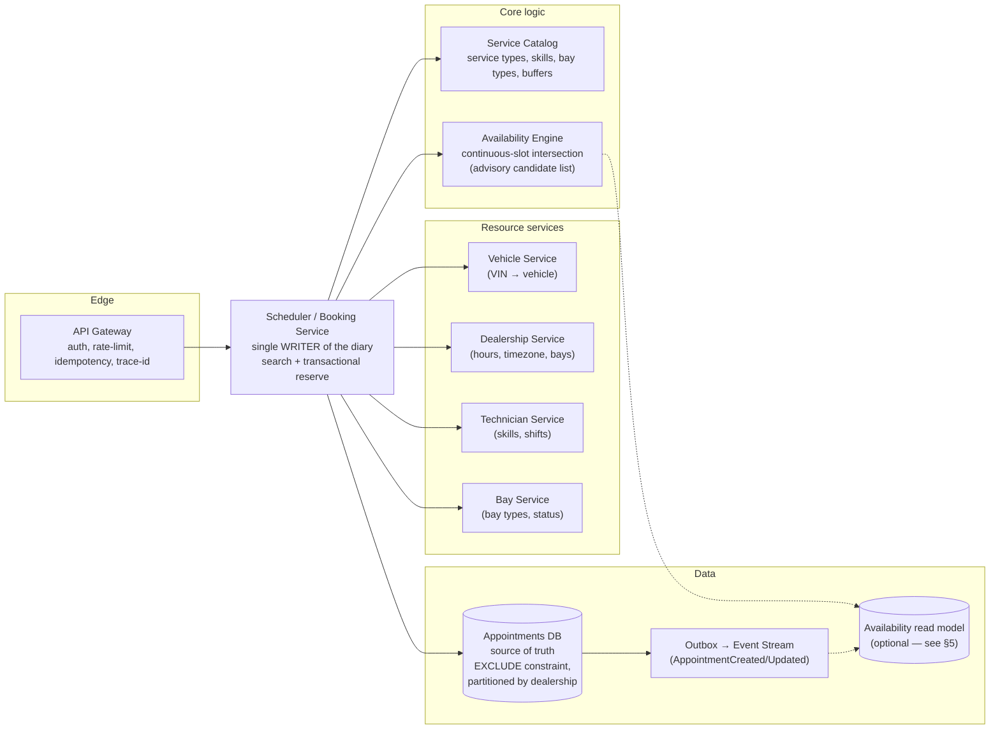
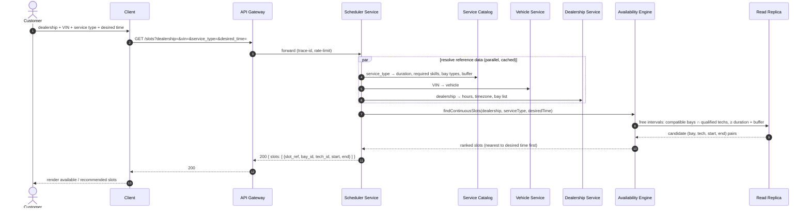
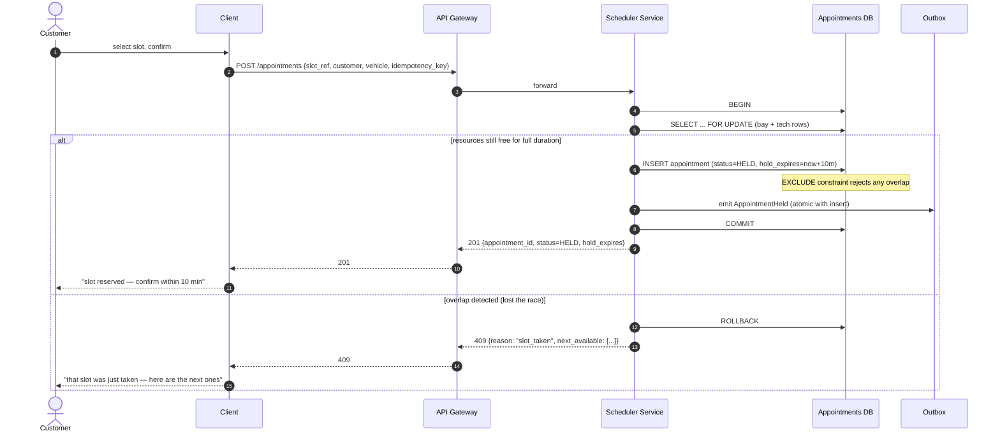

# Booking Flow Design Review — Scenario A

> Scope: the flow where a customer requests slots to book a service appointment at a dealership.

## Context: my reading of the current design

- `GET /api/tickets?service_type=&dealership=&desired_time=&vin=` → API gateway → scheduler service.
- Scheduler fans out to vehicle / dealership / service-bay / technician services.
- Technician service and bay service each compute "available appropriate" resources from the `scheduler` table.
- "Each subsequent service will hold replicas of the schedules DB for queries."
- Schema: `service_bay`, `dealership`, `scheduler` (start/end/duration/bay/dealership/tech), `technician(skill_id)`.

**Assumptions:** MVP is multi-dealership-capable but single-region; synchronous REST internally; a relational DB (PostgreSQL) as the source of truth — the concurrency fixes are DB-agnostic but I name the Postgres mechanism where it is cleanest. "Real-time" means *correctness at the moment of booking* first, with live UI push as an optional layer.

---

## 1. Weak points & improvements (concurrency, scalability, real-time)

### 1.1 The biggest one: check-then-act with no reservation step

Search (`GET`) is read-only, and then "on confirmation → create appointment" happens with no locking described. Two customers see the same slot, both confirm → double booking. This directly violates the "no double booking / no over-promise" NFR.

**Fix — separate "available slot" from "executable commitment":**

- Search returns *candidate* slots (best-effort, may be slightly stale).
- Confirm does a **transactional check-and-reserve**: inside one DB transaction, re-verify both resources are still free for the full duration, then insert the appointment. Enforce it **in the database, not in app code**:
  - Postgres: an exclusion constraint on the diary table — `EXCLUDE USING gist (dealership_id WITH =, service_bay_id WITH =, tsrange(start_at, end_at) WITH &&)` (and a second one for `technician_id`). Any overlapping insert for the same bay *or* the same tech throws.
  - Generic equivalent: `SELECT ... FOR UPDATE` on the bay/tech rows in a transaction, then conditional insert.
- Add an **idempotency key** to `POST /appointments` so a client retry after a network timeout can't create two bookings.
- Consider a short **hold** (`status=HELD`, `hold_expires = now + 5–10 min`) for the reserved slot while the customer completes confirmation; a reaper job expires abandoned holds.

### 1.2 Data model gaps (they block the whole flow)

| Problem in current schema | Why it breaks the flow | Fix |
|---|---|---|
| `technician.skill_id` is single-valued | Techs have multiple skills; a service needs a *set* of skills | `technician_skill` join table (see §2) |
| No `service_type` table | Search needs duration + required skills + allowed bay types | `service_type(id, code, duration_min, buffer_min, ...)` + `service_type_required_skill` + `service_type_bay_type` |
| `scheduler` doubles as calendar and appointment; no `customer_id` / `vehicle_id` / `service_type_id` / `status` | Can't produce "a single record linking Customer↔Vehicle↔Tech↔Bay↔Type↔Time" (mandatory requirement 3) | Rename/keep `appointment` as source of truth with all FKs + `status` state machine (`HELD → CONFIRMED → COMPLETED / CANCELLED / NO_SHOW`) |
| No shift / hours / break data | "Free for the *entire* duration" is uncheckable without working hours | `technician_shift` / `technician_availability` (recurring + exceptions); `dealership.hours`/`timezone` |
| `technician` has no `dealership_id` | Multi-dealership scalability breaks | add `dealership_id` + index everything by `(dealership_id, ...)` |

Store all times in **UTC**, with the dealership's timezone kept separately (DST and cross-timezone correctness).

### 1.3 Scalability: "replicas of schedules DB in every service" is the anti-pattern to remove

- **Stale reads** — you promise "real-time availability" but read from lagging replicas.
- **Write amplification & ownership confusion** — in the diagram, `dealership service` reads `schedules db` directly while `scheduler service` also fans out to it.
- **Sync infra for no benefit**.

**Fix — single source of truth + cached reference data, not replicated diaries:**

- **One writer** owns the diary: the scheduler/booking service. Everyone reads through it (or a dedicated **Availability Engine** read model fed by an outbox/event stream, allowed to be a few-hundred-ms behind — only the commit path must be strongly consistent).
- **Reference data is cheap to cache, diaries are not.** Service types, skills, bay types, dealership hours change rarely → cache with TTL.
- **Multi-dealership scaling** = partition/shard the diary by `dealership_id`. A dealership's load (and booking races) are naturally isolated; no cross-dealership contention in the reservation path.

### 1.4 Real-time checks — do it twice, and define which "real-time" you mean

- **Real-time correctness (must-have):** availability re-verified atomically at commit (§1.1).
- **Real-time UX (should-have, defer):** emit `AppointmentCreated/Updated/Cancelled` from the outbox and push to diary viewers via SSE/WebSocket. Do *not* make the search endpoint itself push.
- **Slot-hold TTL** is the cheap middle ground: a held slot is temporarily invisible to other searchers.

### 1.5 API/flow issues

- **Naming**: `tickets` vs the domain's `appointments` — pick `appointments`/`slots` and be consistent (the diagram also spells "Cilent").
- **The hard part is glossed over**: "consolidate available bay intervals with available tech intervals into continuous slots." That intersection — *for each (compatible bay, compatible tech) pair, find overlapping free intervals ≥ duration + buffer* — is the actual algorithm. Make it an explicit **Availability Engine** responsibility (§3).
- **Parallelize the fan-out**: vehicle, dealership, service-catalog lookups are independent — call them concurrently, with timeouts and circuit breakers. Cache reference lookups.
- **Duration + buffer must be in the window check**, not just start-time. A 4 h job can't fit a 2 h gap; a 30 min buffer must sit between jobs.

---

## 2. Three ways to model technician skills + bay constraints

Skill modeling and bay-constraint modeling are **orthogonal** — both need to exist. Each option below handles both.

| | **A. Normalized relational (join tables)** | **B. Denormalized tags/arrays (JSONB + GIN)** | **C. Capability graph + rules engine** |
|---|---|---|---|
| **Skills** | `skill` + `technician_skill(technician_id, skill_id, proficiency, certified_at, expires_at)`; `service_type_required_skill(service_type_id, skill_id, min_proficiency)` | `technician.skills TEXT[]` (or JSONB), `service_type.required_skills TEXT[]`; match with `skills @> required_skills` | Skills as capability *nodes*; tech "provides", service "requires"; solver checks all constraints |
| **Bay constraints** | `bay_type` + `service_bay.bay_type_id` + `service_type_bay_type(service_type_id, bay_type_id, kind: required\|preferred)` | `service_bay.bay_types TEXT[]`, `service_type.allowed_bay_types TEXT[]` | Bay type + tech↔bay pairing as graph/rule constraints |
| **Matching query** | SQL join: techs whose skill set ⊇ required ∧ bay type allowed | Array containment (`@>`) on GIN indexes | Constraint-solver evaluation over a filtered candidate set |
| **Expressiveness** | High — proficiency, cert expiry, required-vs-preferred, audit trail | Low-medium — presence/absence only; expiry/proficiency need extra columns anyway | Highest — arbitrary future constraints (parts, loaner, co-location) |
| **Perf** | Good with proper indexes; N+1 risk if naive | Excellent for simple containment; degrades once you bolt on expiry/proficiency | Depends on solver; usually overkill for slot search |
| **Evolvability** | Standard, boring, predictable | Fast to prototype; schema drift risk | Powerful but you now own a rules engine |
| **Complexity** | Medium | Low | High |
| **When to pick** | **Recommended default** — real DMS-style system, matches the brief's "certifications + skill matching" | MVP/prototype when speed matters and skill detail is flat | Future, if constraints grow beyond skill+bay (parts, loaner, multi-step jobs) |

**Recommendation: A (normalized), with B's pragmatism for the catalog.** Use join tables for skills and bay types — the source of truth, matching the brief's emphasis on certifications and skill matching. Keep the *time* constraint out of these tables and enforce it as a DB exclusion constraint (§1.1), because "available for the full duration" is an interval problem, not a skills problem. Add `proficiency` only if you actually need junior-vs-master routing now.

Two extra bay-constraint points:

- **Both bay and technician are single-capacity interval resources** (one job at a time each). Model them the same way: an exclusion over `(resource, time_range)`. The "1.5 bays per technician" figure is a *capacity-planning target*, not a booking rule — use it as a ranking hint or dashboard metric.
- **Required vs preferred bay type matters.** "Preferred" should *rank* a slot lower, not exclude it; "required" excludes. Keep this distinction from day one.

---

## 3. First-pass architecture + sequence diagrams

### 3.1 Architecture (component responsibilities)

**Key changes vs the original diagram:**

1. **Scheduler is the single writer** of the diary; nobody else touches it (remove `dealership service` reading `schedules db` directly).
2. **Availability Engine** owns the hard algorithm (interval intersection) behind a stable module boundary; its output is **advisory only**. A dedicated read model (dashed edges) is **optional** — see §5. Correctness lives only at commit.
3. **Reference data (catalog/vehicle/dealership/tech/bay) is cached, not the schedule.** No "replicas of schedules DB in every service."
4. **Outbox/event stream** feeds the (optional) read model, diary viewers, and future reminder workflows.

### 3.2 Sequence — slot search (`GET /slots`)

### 3.3 Sequence — booking confirm (`POST /appointments`) with the race handled

Then a short **finalize** step: `HELD → CONFIRMED` (on customer confirmation/payment) and a **reaper** job that flips expired `HELD` appointments back to released. Both update the *same* record "in place" (the durability NFR), emitting events so the read model and diary stay current.

---

## 4. Observability, failure modes, edge cases

### Observability

- **Correlation ID + distributed tracing** (OpenTelemetry) across gateway → scheduler → fan-out. Measure search p50/p95/p99 and per-downstream-call latency.
- **Metrics:**
  - Booking **conflict rate** (commits rejected by the EXCLUDE constraint) — the signal that stale reads/holds are hurting UX.
  - Search QPS, search latency, availability-engine query latency, hold→confirm conversion, abandoned-hold rate.
  - DB lock contention and replication lag (alert on lag).
- **Business metrics:** actual vs estimated duration, bay/tech utilization, buffer consumption, overrun rate.
- **Alerts:** conflict-rate spike, search-latency spike, downstream failure rate, replica lag > threshold, hold-reaper not running.
- **Audit log:** every appointment create/update with actor + timestamp + prior state.

### Failure modes (and the mitigation)

| Failure | Mitigation |
|---|---|
| One downstream (vehicle/dealership) times out during search | Parallel calls + per-call timeout + circuit breaker; degrade gracefully or fail fast — never hang |
| Bay service up, tech service down | Skill data is slow-changing → cache it; search still runs, commit re-validates authoritatively |
| DB down / replica lag during search | Search shows slightly stale slots; commit still re-checks → **no over-promise** |
| Concurrent booking race | EXCLUDE constraint rejects loser with 409 + next slots |
| Customer abandons a held slot | Hold TTL + reaper releases it |
| Job overruns cascade through the day | 15–20% buffer, reschedule/reflow workflow, overrun metrics |
| Technician absent / bay out-of-service after booking | `status` transitions (`CONFIRMED → RESCHEDULE_NEEDED`) + rebooking flow |
| Client retries `POST` after a timeout | Idempotency key dedupes; return the same appointment |
| Clock/timezone bugs | UTC storage + dealership timezone; DST boundary tests |

### Edge cases

- **Duration-aware continuous slot**: 4 h job vs 2 h gap → must not match; 30–45 min buffer between adjacent jobs.
- **Tech must be free for the *entire* duration**, not just at the start.
- **A tech is single-capacity too** — can't be in two bays simultaneously; both need exclusion.
- **Shift/boundary jobs**: job spanning lunch, breaks, or a shift end.
- **Multi-day jobs** (major repair 4 h+, or spanning overnight).
- **Desired time in the past**, or outside dealership hours.
- **Required vs preferred bay type** (diagnostic job must not land in an express-lube bay).
- **Skill proficiency routing**: don't assign a complex diagnostic to a new tech / an oil change to a master tech.
- **Walk-ins vs pre-booked** tension (buffer + reserved capacity).
- **Unknown VIN / unknown vehicle** in the vehicle-service lookup.
- **Cross-dealership leakage**: a tech or bay must never be offered from a different dealership (partitioning + `dealership_id` on every query).
- **Recommended-slot ranking** when multiple slots match: nearest to desired time first, then preferred-bay before required-only, then fewer buffer violations.

## 5. Design decisions & FAQ

### Decision log

| Decision | Choice | Why | Revisit when |
|---|---|---|---|
| Where the Availability Engine reads from | Same Postgres as the scheduler, behind a dedicated **Availability module**. A read model / replica is **optional**. | One dealership has no search traffic to isolate, and the boundary that matters is the *module interface*, not the physical store. An extra read path adds a failure mode and lag-induced conflicts. | Search QPS/latency starts competing with the booking commit path. Then add a **derived free-interval read model fed by the outbox** — not a whole-database replica. |
| Authority of availability data | Always **advisory**; the commit path reads the primary and re-checks transactionally. | Only the DB `EXCLUDE` constraint can guarantee "no double booking"; a search-time read cannot. | Never — this is the invariant the flow rests on. |
| What the client sees | **Ranked recommended slots** (advisory) + a short **hold** on selection. | Matches the brief's happy path ("present available slots, or reject and suggest alternatives") and the friction-reduction goal. | Never for search; hold duration may change. |
| Caching "is_available"? | Never cache a boolean. Cache **raw busy-intervals** only. | A cached availability flag goes stale and lies; busy-intervals plus a cheap interval-difference stay fresh. | — |

### FAQ

**Why doesn't the Availability Engine read the Appointments DB directly?**
For the MVP it can, and probably should. What must not change is *how* it reads: through a **module boundary** (`findContinuousSlots(...)`) whose output is treated as a **candidate list, not a promise**. Routing through a dedicated read model/replica is a scalability lever for when search traffic competes with the booking commit path; at a single dealership that lever buys nothing and costs you replication lag — which surfaces as extra "slot was taken" conflicts. Keep the boundary, defer the replica; if you add one later, feed it from outbox events rather than replicating the whole database. (In the §3.1 diagram the read model is drawn with dashed, optional edges.)

**Should the client show recommended slots, or just return unavailable at booking time?**
Show recommended slots. The brief's happy path explicitly presents available slots (or rejects and suggests alternatives), and hiding them reintroduces exactly the booking friction the scenario is meant to remove. Model it as two calls with different authority:

- `GET /slots` — read-only, **best-effort/advisory**: a ranked, duration-aware list of continuous slots ("available as of now").
- `POST /appointments` — **authoritative**: success (a `HELD` → `CONFIRMED` record) or `409 { reason: "slot_taken", next_available: [...] }` — always with alternatives, never a bare failure.

Reserve with a short **hold (TTL)** so "shown" becomes "guaranteed for N minutes" — that is how "we showed a slot" is reconciled with "someone else took it". Anti-patterns to avoid: returning `200` for a slot you cannot actually reserve; checking availability only at confirm time (forces a retry loop and spikes conflicts); dumping an unbounded list of every free minute.

---

*The single most important structural change: make the scheduler the single writer of a diary with a DB-level no-overlap guarantee, do the availability check twice (search best-effort + commit authoritative), and stop replicating schedules into every service.*
